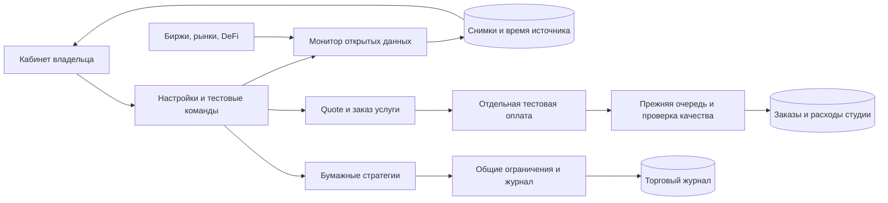

# Кабинет направлений и подготовка запуска

13.10.2026. Разработка и проверка локально, VPS не обновляется. Кабинет: **http://localhost:3210/office/earnings**. Из торговли открывается ссылкой «Направления».

## Что получилось

Один экран объединяет девять направлений, но не смешивает их деньги и готовность. Для каждого показаны реализованное поведение, ограничения, требования к заказчику и первичный источник. На телефоне выбирается одно направление. Торговые остановки и история прежней студии сохраняются.

| Направление                | Что можно проверить                                                                                       | Что ещё нужно реализовать или принять                                                                                         |
| -------------------------- | --------------------------------------------------------------------------------------------------------- | ----------------------------------------------------------------------------------------------------------------------------- |
| Спотовая торговля          | Полный прежний движок четырёх бирж, динамический подбор монет, бумажные ордера и риски                    | Приватная приёмка выбранных Demo/Live аккаунтов, прибыльный кандидат. LLM-менеджера гипотез в торговом цикле нет              |
| Сетка, DCA                 | Два новых семейства, выбор набора в «Стратегиях», сохранение ступеней после рестарта, общий риск-контроль | Только Paper; отдельная приёмка состояния и исполнения перед Demo/Live                                                        |
| Арбитраж, MEV              | Сравнение свежих bid/ask четырёх бирж с затратами                                                         | Исполнение двух сторон, подтверждение идентичности токенов, проверка глубины и восстановление. MEV требует отдельного проекта |
| Фандинг, стейкинг, DeFi    | Реальные ставки Bybit/OKX и выборка пулов DefiLlama                                                       | Хеджирование, маржа, ликвидация, аудит протокола, отдельный подписант и on-chain исполнитель                                  |
| Polymarket, Kalshi         | Открытые события, цены исходов, объём и сроки                                                             | Собственная вероятность/бэктест и торговый адаптер. Доступность зависит от правил площадки; РФ ограничена                     |
| Мемкоины, персонаж, токены | Ликвидные мемкоины могут попасть в спот; студия готовит тексты                                            | Публикации в каналах, DEX и выпуск своего токена не реализованы                                                               |
| Аирдропы                   | Исследование архитектуры и требований конкретных кампаний                                                 | Нет автоматического реестра/участия/claim; нужны выбранные программы и допустимые действия                                    |
| Агент как бизнес           | 12 текстовых контрактов, версии продуктов, очередь, тестовые заказы и проверка качества                   | Подтверждённый спрос, настоящий платёжный адаптер, условия продажи и поддержка                                                |
| Услуги агентам, x402       | Закрытые каталог, quote, идемпотентный job и получение результата                                         | Авторизация сторонних клиентов, x402 SDK/facilitator, расчёт платежа и приёмка ещё не реализованы                             |

Это рабочие локальные модули и явно обозначенные следующие этапы. Передача ключей не превращает направления со статусом «Наблюдение» или «Проектирование» в торговлю.

## Как работает мониторинг

«Включить мониторинг» сохраняет расписание в PostgreSQL. Worker независимо от торговых циклов раз в 15 минут получает пять публичных источников и сравнивает каталоги спота. «Обновить снимок» ставит одно задание даже при выключенном расписании; повторы ограничены минутой. Если worker остановлен, запрос остаётся видимым в ожидании. «Выключить расписание» прекращает следующие проходы; начатое чтение может завершиться.

Атомарная аренда `earnings_monitor` не допускает одновременный сбор несколькими worker. Истёкшая или заменённая аренда не может перезаписать новый снимок. Нет ордеров, кошелька, бюджета модели или включения торговли. Ответы приходят только с фиксированных официальных хостов, с таймаутом, проверкой схем и ограничением размера. Decimal-значения не проходят через float-учёт.

Ошибки источников независимы. При сбое последний удачный снимок сохраняется с прежним временем и явным статусом ошибки. У публичного сравнения котировок срок актуальности определяется исходным временем цены, а не моментом сохранения. Разница после допущений не является зафиксированной прибылью: тарифы аккаунта, идентичность токена, размер стакана, инвентарь, переводы и ребалансировка ещё не подтверждены. У DeFi время загрузки отдельно от отсутствующего upstream-времени расчёта.

Монитор не подключён к исполнению торговли. Единственный реализованный контур реальных ордеров остаётся прежним спотовым адаптером с ключами, отдельным разрешением Live и обязательными проверками. Новые Grid/DCA дополнительно закрыты для приватных режимов ограничением БД и сервера.

## Что получить от заказчика

Для **текущей спотовой торговли**:

1. Выбранные доступные заказчику биржи и выделенные верифицированные аккаунты. Все четыре не обязательны.
2. Отдельные Demo/Testnet ключи и тестовые средства. Затем Live-ключи: чтение и спотовая торговля, без вывода, с привязкой к IP. Для OKX/Bitget также API passphrase. Секреты вводятся в окружение сервера.
3. Начальный бюджет каждой биржи и согласованный убыток. Заказчик самостоятельно пополняет торговый аккаунт USDT. Минимум текущего реального портфеля 20 USDT; 100 USDT не предел. Счёт выделенный, без иных активов, ордеров, займов и ботов до первого запуска.
4. Постоянный сервер со статическим IP в допустимом для аккаунта регионе и ответственный за исключения/остановку.

После этого ещё нужно **выполнить**, а не просто отметить: приватный Demo-цикл покупки/продажи со сверкой; проверку восстановления после неопределённого ответа; накопление прибыльного бумажного кандидата от 7 дней и 20 закрытых позиций; отдельный выбор суммы и подтверждение Live. Общие лимиты: вход до 10 USDT, вложение до 50%, дневной убыток 2%, просадка 10%, позиционный стоп 3%. Они не гарантируют цену закрытия или доход. Длительная приёмка и независимые резервные копии/оповещения ещё нужны.

Для **новой сетки/DCA** локальный тест не требует доступов. Перед реальными деньгами нужна дополнительная разработка допуска и отдельная приёмка; прежние Live-ключи сами её не включают.

Для **арбитража** нужны минимум две выбранные биржи, фактические комиссии, отдельные API-ключи и заранее распределённые деньги/монеты. До пополнения следует реализовать и проверить исполнение двух сторон и ограничения инвентаря. Для **MEV** дополнительно выбираются сеть, допустимый вид стратегии, RPC, подписант, бюджет газа и инфраструктура симуляции.

Для **фандинга** нужны право доступа к деривативам, аккаунт, капитал на спот и хедж, правила маржи и ликвидации. Для **стейкинга/DeFi**: конкретные сеть/протокол/контракты, их проверка, отдельный кошелёк владельца и бюджет газа. В обоих случаях ещё требуется исполнитель. Seed-фразы не передаются модели или через чат.

Для **рынков предсказаний** сначала проверяется право конкретного лица пользоваться площадкой. В действующей документации Polymarket РФ находится в close-only, Kalshi перечисляет РФ среди restricted jurisdictions. Поэтому для заказчика из РФ нельзя обещать новые ставки после предоставления кошелька. При подходящей юрисдикции дальше нужны верифицированный аккаунт/ключи, источники фактов, критерии прогноза, лимит риска и разработка/приёмка адаптера. [Polymarket](https://docs.polymarket.com/api-reference/geoblock), [Kalshi, раздел VI](https://kalshi.com/docs/kalshi-member-agreement.pdf).

Для **контента/персонажа**: тема, аудитория, права на материалы, аккаунты каналов и разрешённые API. Для **своего токена**: назначение, сеть, юридическая схема, проверенный контракт и бюджет; выпуск сам по себе не создаёт спрос. Для **аирдропов**: конкретные официальные программы, условия участия, отдельный кошелёк и лимит газа. Награда заранее неизвестна; массовые фиктивные аккаунты и обход правил не входят в разработку.

Для **бизнеса на услугах**: одна выбранная услуга, 5–10 обезличенных примеров с критериями результата, права на материалы, модель/бюджет, канал привлечения, цена, данные продавца, поддержка и платёжная схема. Для **услуг другим агентам** дополнительно нужен пример клиента и контракт API. Для **x402**: выбранные сеть/актив, публичный адрес получения, facilitator и тестовый покупатель. Далее ещё предстоят реализация официального протокола и сквозная приёмка; текущий ETH Sepolia его не заменяет.

## Где смотреть детали

- [Торговая проверка и классические стратегии](22-trading-audit.md).
- [Исследование других рынков, источники и архитектурные границы](23-opportunity-research.md).
- [API услуг и отдельный план x402](24-agent-services.md).
- [Фактическая приёмка и ограничения](STATUS.md).
