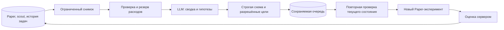

# LLM-менеджер торговых стратегий

Продакшен: **https://farm.89.19.215.46.sslip.io/office/manager**, локально: **http://localhost:3210/office/manager**. Ссылки «Менеджер» находятся в торговле и направлениях.

Менеджер использует модель собственного профиля в кабинете. С 10.11.2026 по поручению владельца предусмотрен отдельный реактивный разбор Bybit Live менеджером и криптоаналитиком Bybit. Для этих двух ролей выбрана `anthropic/claude-opus-5.5`; остальные профили сохраняются. Исполнение сделок остаётся детерминированным серверным кодом.

## Реакция на результаты Bybit Live

Локальный флаг `BYBIT_STRATEGY_REVIEW_ENABLED=true` разрешает работу только с уже активированным Bybit Live; также требуется обычный `TRADING_LIVE_ENABLED`. Флаг не включает торговлю и не снимает остановки. Другая биржа, Demo и Paper не становятся целями этого механизма.

На следующем проходе worker новый закрытый убыток, дальнейшее ухудшение оценки на шаг 0,5% капитала, дневной/общий риск-стоп либо простой от шести часов запрашивает разбор без шестичасового ожидания. Первый запуск учитывает существующий убыток. Снимок содержит факты сделок и комиссий, текущую оценку всех остатков, выбранные scout пары, правила владельца и три предыдущих разбора. Чужих ключей, идентификатора аккаунта или свободного доступа к сети у моделей нет; «поиск улучшений» означает анализ этого снимка, а не новости или обещание найденной доходной стратегии.

Менеджер предлагает одну гипотезу: `reversion`, `trend` или `breakout` и только прежние диапазоны `lookback`, `entryBps`, `takeProfitBps`. Отдельный аналитик Bybit проверяет обоснование и может отклонить предложение. Оба ответа проходят строгие схемы. Допустим отказ от изменения при недостатке данных. Результат и проверка видны в кабинете менеджера, расходы проходят общий журнал.

Сервер применяет согласованное изменение один раз, только при включённой торговле, нулевых base/basis основного слота, свежем scout и котировке, отсутствии неопределённого ордера, неизменных исходных параметрах/последней заявке, ревизии инструкций и капитале. Капитал, деньги, история риска, счётчики сделок и остатки не переписываются; старые параметры и снимок сохраняются в `trading_live_reviews` и событии. Scout по-прежнему выбирает пары сам. Идея действует шесть часов. После новой сделки или редактирования инструкций устаревшая идея отклоняется. Изменения параметров не доказывают улучшение: следующий разбор получает фактические результаты после применения.

Разбор доступен при `DAILY_LOSS_LIMIT`/`DRAWDOWN_LIMIT`, но предложение ждёт разрешённого владельцем продолжения. Ручная остановка Bybit не запускает новый реактивный разбор. Общая пауза системы и выключенный менеджер блокируют вызовы и применение. Неизвестная стоимость вызова блокирует следующие запросы.

Одинаковый повод не оплачивается повторно. Минимальный интервал **30 минут** и общий дневной предел менеджера (по умолчанию **4 разбора**) сохранены; два вызова внутри одного разбора используют один резерв. Сначала оценивается стоимость обеих моделей. Если лимит/резерв недостаточен, запрос не отправляется. Новый убыток во время интервала остаётся поводом для следующего допустимого прохода. Риск-стоп без новых фактов не вызывает бесконечную оплату анализа.

## Бумажные эксперименты

Ниже описан прежний Paper-механизм, который сохраняет отдельные задачи и права. При настоящем провайдере без свободных бумажных целей платный Paper-разбор пропускается. Этот пропуск не блокирует отдельный реактивный разбор Bybit.

## Что делает самостоятельно

После включения менеджер раз в шесть часов (по умолчанию; `MANAGER_RUNS_PER_DAY` от 1 до 12) получает ограниченный снимок четырёх Paper-портфелей: состояние и причины остановки, параметры и результат агентов, свежесть отбора монет, предыдущие задачи и их итоги. Настроенная модель возвращает русскую сводку и до четырёх проверяемых гипотез. На одну биржу разрешён один незавершённый эксперимент. Если данных недостаточно, нормальный результат — сводка без задач.

Разрешённая задача — заменить одного свободного неприбыльного Paper-агента возрастом от 24 часов на вариант `reversion`, `trend`, `breakout`, `grid` или `dca`. Модель выбирает только семейство и три ограниченных параметра: число свечей, порог входа и фиксацию прибыли. Монеты продолжает выбирать серверный scout; проверяется стратегия вместе с динамическим отбором, а не обещание результата конкретной монеты. Прибыльные агенты сохраняются для дальнейшего накопления данных.

Сервер повторно проверяет сохранённое предложение непосредственно перед применением. Нужны работающая тренировка, свежий scout, отсутствие позиции и неизвестных ордеров, неизменная цель и отсутствие приоритетной смены набора владельцем. Старый агент архивируется, новый получает его фактические свободные средства и собственную историю с нуля. Капитал, дневная база, пик и поколение портфеля не меняются. Старая статистика не становится результатом новой гипотезы.

После применения задача наблюдает за новым агентом. Первая оценка возможна спустя 24 часа и пять закрытых позиций. Сервер считает результат с торговыми комиссиями, просадку и число закрытий. Свежая цена обязательна для оценки открытых активов. Через семь дней без достаточной выборки фиксируется недостаток данных. Если агент заменён владельцем, эксперимент отмечается прерванным. Следующий разбор получает эти результаты: модель может оставить успешных агентов и предложить новую проверку слабому.

Это промежуточная проверка гипотезы, не доказательство доходности и не разрешение Live. Пороги семи дней/20 закрытий используются для оценки Paper; владелец снял их как условие запуска Live 28.10.2026. Grid/DCA остаются Paper-only.

## Управление

- **Включить менеджера:** разрешить расписание и выполнение проверенных бумажных задач. Эта команда не запускает торговлю.
- **Разобрать сейчас:** запросить дополнительный разбор в пределах лимитов. Между запросами не менее 30 минут, всего до четырёх запусков за сутки UTC. Переключение выключить/включить лимиты не обнуляет.
- **Выключить менеджера:** прекратить новые разборы и применение ожидающих задач. Ответ уже начатого разбора не применяется. Уже работающие торговые агенты продолжают под обычным контролем торговли; для их остановки используется торговый кабинет. Сервер продолжает фиксировать итоги ранее начатых экспериментов.

Задачи демонстрационного разбора (`MODEL_PROVIDER=demo`) не занимают слоты настоящей модели: при любом другом провайдере они истекают с причиной `MANAGER_DEMO_RELEASED`; уже применённые агенты продолжают торговать. Платный разбор (openai/yandex) не вызывает модель и не резервирует бюджет, если все Paper на паузе (`MANAGER_SKIP_PAPER_PAUSED`), на всех работающих биржах уже идёт эксперимент (`MANAGER_SKIP_NO_SLOTS`) или нет агента для эксперимента (`MANAGER_SKIP_NO_CANDIDATES`). Причина показывается в кабинете и пишется в аудит; разбор запускается, как только появится слот.

Задачи сохраняются в PostgreSQL. Они могут ждать свежих данных, свободного слота или восстановления работы портфеля; необработанная идея истекает через 48 часов. Причина видна рядом с задачей. Изменение владельцем набора стратегий делает старое предложение неприменимым, даже если ответ модели пришёл позднее.

Дневной стоп, общий стоп, ручная пауза и отключение студии не снимаются менеджером. На действующем стенде нужно учитывать прежние остановки по убытку: включение менеджера не означает возобновление покупок.

## Модель и расходы

Используется существующий `MODEL_PROVIDER`, новый ключ не требуется, если подходящая модель уже настроена. Рабочие варианты для этого бюджетного режима — бесплатная модель OpenRouter или локальная Ollama. В режиме `demo` сервер использует явно помеченный готовый пример; он не выдаётся за ответ LLM. Пометка сохраняется у запуска и каждой задачи после смены провайдера.

Общий мастер-промпт читается для новой роли «Торговый менеджер». Модель не имеет инструментов, секретов, shell, SQL, произвольного HTTP и доступа к биржевым ордерам. Она возвращает только данные по строгой схеме; лишние поля, чужие агенты, недопустимые параметры и повтор одного эксперимента отклоняются. Денежные значения в снимке представлены десятичными строками с явными единицами.

Расходы проходят через прежний резерв и журнал вызовов. Максимум одного разбора — **500 копеек**, менеджера за сутки — **2000 копеек**; для платной GPT-6 Astra (`MODEL_PROVIDER=openai`) по умолчанию **120 ₽** и **480 ₽**, потолки настроек `MANAGER_RESERVE_KOPECKS`/`MANAGER_DAILY_KOPECKS` — 200 ₽ и 1000 ₽ (см. [33-autonomy.md](33-autonomy.md)); общие дневной/месячный лимиты и защищённый бюджет принятых заказов действуют дополнительно. Неопределённый платный вызов требует проверки и не повторяется автоматически. Бесплатность OpenRouter проверяется существующим адаптером; переход на платную модель скрыто не выполняется.

До отправки проверяется реальный консервативный резерв запроса. Если резерв задан меньше оценки запроса (например, прежние 5 ₽ для Astra), кабинет показывает `MANAGER_MODEL_TOO_EXPENSIVE`, сеть и суточная попытка не расходуются. Лимиты не увеличиваются ради прохождения запроса. Для фактического полного контекста оценка повторяется перед вызовом.

Затраты модели показываются отдельно в рублях, торговый результат — в USDT после торговых комиссий. Курса пересчёта расходов модели в торговый P&L нет: их нельзя складывать как одну валюту или заявлять суммарную чистую прибыль.

## Устойчивость и границы

Модель вызывается вне торговых блокировок. Запуск защищён уникальной активной записью, ограничением попыток и арендой на 22 минуты — дольше максимально разрешённых 10 минут Ollama плюс одной попытки исправить формат. Истёкший обработчик не может записать новый план. Восстановление аренды работает и при недоступной модели; расходы и история вызовов сохраняются.

Применение выполняется под прежней блокировкой биржи/Paper, в одной транзакции с архивированием, созданием агента и сменой состояния задачи. Ключи портфеля неизменны; блокировка `NO KEY UPDATE` сохраняет сериализацию изменений денег и остановок, разрешая проверку внешних ключей публикуемой задачи. Пока задача наблюдает за агентом, прежний отбор поколения не заменяет весь состав за её спиной. Ротация подходящих монет и риск-выходы продолжаются.

Paper-задачи не меняют Demo/Live. Отдельное разрешение Bybit выше ограничено параметрами; менеджер не переводит деньги, не увеличивает ставки после убытка, не снимает ограничения, не пишет исполняемый код и не создаёт произвольные работы. Управление DeFi, MEV, ставками, публикациями и x402 в эту роль не входит.

Фактические проверки, состояние локального провайдера и результат контрольного запуска: [STATUS.md](STATUS.md).

## Применение новых инструкций без перезапуска

Модель в «Инструкциях для торговли» используется и для разбора свободного текста, и для следующего анализа менеджера. При сохранении инструкции выбранная модель и её тариф действуют уже в запросе разбора, до записи проверенных правил. «Сохранить модель» позволяет поменять только модель: текст, материалы и исполняемые торговые правила сохраняются; перепроверка текста и платный вызов не требуются. Поздние предложения прежней модели отклоняются тем же контролем ревизии. Остальные роли сохраняют свои модели.

С 05.11.2026 изменение инструкции менеджера или его/общих материалов увеличивает ревизию и запрашивает следующий допустимый разбор, если менеджер включён. Сохранение не включает выключенного менеджера и не обходит бюджет, свободные слоты, суточный предел или 30-минутный интервал. Ожидающие предложения старой ревизии отклоняются; поздний ответ старого разбора не может создать задачи. Новый разбор загружает свежий профиль. Уже оплаченный вызов сохраняется в журнале, наблюдение за начатыми экспериментами продолжается.

Торговые условия из текста отдельно преобразуются в проверяемые настройки спотового движка и применяются перед следующим действием трейдеров. Советы по анализу остаются рекомендациями менеджеру; файлы контекста сами по себе не устанавливают запреты заявок. Само сохранение инструкции не разрешает Live-действия. Отдельный Bybit-механизм выше принимает только ограниченные параметры, а не произвольные действия. См. [инструкцию пользователя](38-user-guide.md#отдельные-инструкции-для-торговли).
