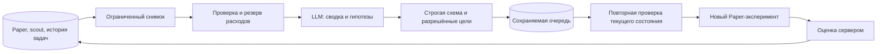

# LLM-менеджер бумажных экспериментов

13.10.2026. Кабинет опубликован: **https://farm.45.114.60.6.sslip.io/office/manager**. Локальный адрес: **http://localhost:3210/office/manager**. Ссылки «Менеджер» находятся в торговле и направлениях.

На локальной установке менеджер включён, выполнен настоящий разбор бесплатной моделью. На VPS раздел доступен, но менеджер выключен: прежний `emergency_stop` сохранён, а настроенная платная модель не помещается в резерв запроса. Публикация не снимала стоп, не переносила локальный ключ и не увеличивала расходы. Для запуска менеджера на VPS нужны подходящий провайдер и отдельное решение владельца о возобновлении модельных задач. Подробности: [10-cloud-vps.md](10-cloud-vps.md).

## Что делает самостоятельно

После включения менеджер раз в шесть часов получает ограниченный снимок четырёх Paper-портфелей: состояние и причины остановки, параметры и результат агентов, свежесть отбора монет, предыдущие задачи и их итоги. Настроенная модель возвращает русскую сводку и до четырёх проверяемых гипотез. На одну биржу разрешён один незавершённый эксперимент. Если данных недостаточно, нормальный результат — сводка без задач.

Разрешённая задача — заменить одного свободного неприбыльного Paper-агента возрастом от 24 часов на вариант `reversion`, `trend`, `breakout`, `grid` или `dca`. Модель выбирает только семейство и три ограниченных параметра: число свечей, порог входа и фиксацию прибыли. Монеты продолжает выбирать серверный scout; проверяется стратегия вместе с динамическим отбором, а не обещание результата конкретной монеты. Прибыльные агенты сохраняются для дальнейшего накопления данных.

Сервер повторно проверяет сохранённое предложение непосредственно перед применением. Нужны работающая тренировка, свежий scout, отсутствие позиции и неизвестных ордеров, неизменная цель и отсутствие приоритетной смены набора владельцем. Старый агент архивируется, новый получает его фактические свободные средства и собственную историю с нуля. Капитал, дневная база, пик и поколение портфеля не меняются. Старая статистика не становится результатом новой гипотезы.

После применения задача наблюдает за новым агентом. Первая оценка возможна спустя 24 часа и пять закрытых позиций. Сервер считает результат с торговыми комиссиями, просадку и число закрытий. Свежая цена обязательна для оценки открытых активов. Через семь дней без достаточной выборки фиксируется недостаток данных. Если агент заменён владельцем, эксперимент отмечается прерванным. Следующий разбор получает эти результаты: модель может оставить успешных агентов и предложить новую проверку слабому.

Это промежуточная проверка гипотезы, не доказательство доходности и не разрешение Live. Прежние пороги семь дней/20 закрытий и фактическая биржевая приёмка сохраняются; grid/DCA остаются Paper-only.

## Управление

- **Включить менеджера:** разрешить расписание и выполнение проверенных бумажных задач. Эта команда не запускает торговлю.
- **Разобрать сейчас:** запросить дополнительный разбор в пределах лимитов. Между запросами не менее 30 минут, всего до четырёх запусков за сутки UTC. Переключение выключить/включить лимиты не обнуляет.
- **Выключить менеджера:** прекратить новые разборы и применение ожидающих задач. Ответ уже начатого разбора не применяется. Уже работающие торговые агенты продолжают под обычным контролем торговли; для их остановки используется торговый кабинет. Сервер продолжает фиксировать итоги ранее начатых экспериментов.

Задачи сохраняются в PostgreSQL. Они могут ждать свежих данных, свободного слота или восстановления работы портфеля; необработанная идея истекает через 48 часов. Причина видна рядом с задачей. Изменение владельцем набора стратегий делает старое предложение неприменимым, даже если ответ модели пришёл позднее.

Дневной стоп, общий стоп, ручная пауза и отключение студии не снимаются менеджером. На действующем стенде нужно учитывать прежние остановки по убытку: включение менеджера не означает возобновление покупок.

## Модель и расходы

Используется существующий `MODEL_PROVIDER`, новый ключ не требуется, если подходящая модель уже настроена. Рабочие варианты для этого бюджетного режима — бесплатная модель OpenRouter или локальная Ollama. В режиме `demo` сервер использует явно помеченный готовый пример; он не выдаётся за ответ LLM. Пометка сохраняется у запуска и каждой задачи после смены провайдера.

Общий мастер-промпт читается для новой роли «Торговый менеджер». Модель не имеет инструментов, секретов, shell, SQL, произвольного HTTP и доступа к биржевым ордерам. Она возвращает только данные по строгой схеме; лишние поля, чужие агенты, недопустимые параметры и повтор одного эксперимента отклоняются. Денежные значения в снимке представлены десятичными строками с явными единицами.

Расходы проходят через прежний резерв и журнал вызовов. Максимум одного разбора — **500 копеек**, менеджера за сутки — **2000 копеек**; общие дневной/месячный лимиты и защищённый бюджет принятых заказов действуют дополнительно. Неопределённый платный вызов требует проверки и не повторяется автоматически. Бесплатность OpenRouter проверяется существующим адаптером; переход на платную модель скрыто не выполняется.

До отправки проверяется реальный консервативный резерв запроса. Текущие платные настройки OpenAI/Yandex по умолчанию в эти пределы не помещаются: кабинет показывает `MANAGER_MODEL_TOO_EXPENSIVE`, сеть и суточная попытка не расходуются. Лимиты не увеличиваются ради прохождения запроса. Для фактического полного контекста оценка повторяется перед вызовом.

Затраты модели показываются отдельно в рублях, торговый результат — в USDT после торговых комиссий. Курса пересчёта расходов модели в торговый P&L нет: их нельзя складывать как одну валюту или заявлять суммарную чистую прибыль.

## Устойчивость и границы

Модель вызывается вне торговых блокировок. Запуск защищён уникальной активной записью, ограничением попыток и арендой на 22 минуты — дольше максимально разрешённых 10 минут Ollama плюс одной попытки исправить формат. Истёкший обработчик не может записать новый план. Восстановление аренды работает и при недоступной модели; расходы и история вызовов сохраняются.

Применение выполняется под прежней блокировкой биржи/Paper, в одной транзакции с архивированием, созданием агента и сменой состояния задачи. Ключи портфеля неизменны; блокировка `NO KEY UPDATE` сохраняет сериализацию изменений денег и остановок, разрешая проверку внешних ключей публикуемой задачи. Пока задача наблюдает за агентом, прежний отбор поколения не заменяет весь состав за её спиной. Ротация подходящих монет и риск-выходы продолжаются.

Менеджер не меняет Demo/Live, не переводит деньги, не увеличивает ставки после убытка, не снимает ограничения, не пишет исполняемый код и не создаёт произвольные работы. Управление DeFi, MEV, ставками, публикациями и x402 в эту роль не входит.

Фактические проверки, состояние локального провайдера и результат контрольного запуска: [STATUS.md](STATUS.md).
